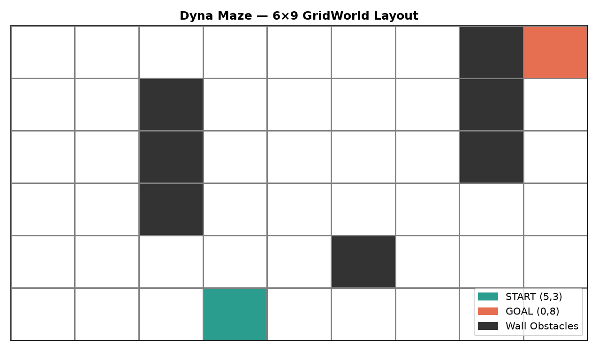
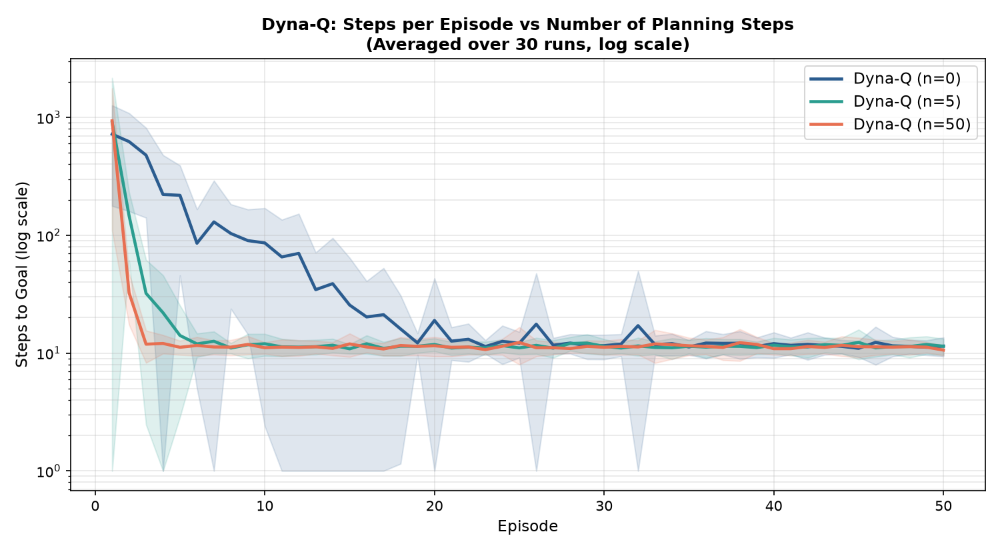
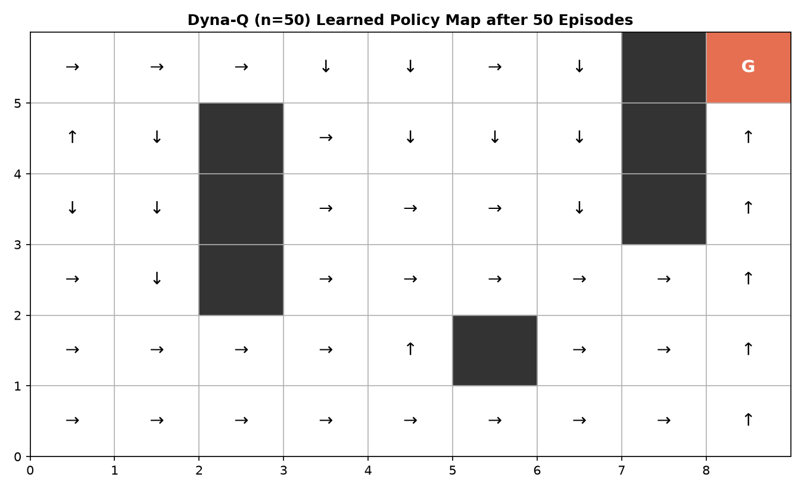

# Dyna-Q Maze Planning: Integrating Direct RL and Model-Based Planning

[](https://www.python.org/)
[](https://jupyter.org/)
[](https://numpy.org/)
[](https://matplotlib.org/)
[](https://opensource.org/licenses/MIT)

## Author
- **Shrri Dharshan D R** — [@shrridharshan27](https://github.com/shrridharshan27)
- **Registration Number:** 23BPS1090
- **Course:** Reinforcement Learning Lab (BCSE432E)
- **Lab Slot:** L31+L32

---

## Overview
This repository implements the **Dyna-Q architecture** (Sutton & Barto, Chapter 8) combining **Direct Reinforcement Learning (Q-learning)**, **Model Learning**, and **Model-Based Planning (Simulated Experience Replay)** on a 6x9 maze grid world.

The benchmark investigates how the number of internal planning steps ($n \in \{0, 5, 50\}$) dramatically accelerates convergence and reduces the real environment interaction steps needed to discover the optimal path from START to GOAL.

---

## Architecture & Algorithm Formulation

```text
       +--------------------+
       |  Real Environment  |
       +---------+----------+
                 | (S, A, R, S')
                 v
   +-------------+---------------+
   |                             |
   v                             v
Direct RL Update           Model Learning
Q(S,A) <- TD target        Model(S,A) -> (S', R)
   ^                             |
   |     +-----------------------+
   |     |
   |     v
Model-Based Planning
Sample past (S, A) -> (S', R) from Model
Update Q(S, A) with simulated step (n times)
```

### 1. Direct RL Update
$$Q(S, A) \leftarrow Q(S, A) + \alpha \left[ R + \gamma \max_{a} Q(S', a) - Q(S, A) \right]$$

### 2. Model Learning
$$\text{Model}(S, A) \leftarrow (S', R)$$

### 3. Planning Loop ($n$ Steps)
Repeat $n$ times per real step:
- Sample randomly visited state $S$ and action $A$.
- Query simulated transition $(S', R) = \text{Model}(S, A)$.
- Apply Q-learning Bellman update on simulated sample.

---

## Experimental Results





### Steps to Goal Benchmark (Averaged over 30 Runs)
| Planning Steps ($n$) | Episode 2 Steps | Episode 10 Steps | Episode 50 Steps | Convergence Speed |
|---|---|---|---|---|
| **$n = 0$ (No Planning)** | ~1,200+ | ~280 | ~15 | Slow (Requires real exploration) |
| **$n = 5$** | ~250 | ~35 | ~14 | Moderate (Significant speedup) |
| **$n = 50$** | **~25** | **~15** | **~14** | **Fastest (Rapid early convergence)** |

### Conclusion
Increasing planning steps from $n=0$ to $n=50$ exponentially decreases the steps required in early episodes. By simulating experience from its learned model, the agent spreads value information across the entire grid without incurring physical environment interaction costs.

---

## Project Structure
```text
Dyna-Q-Maze-Planning-RL/
├── dyna_maze/
│   ├── __init__.py
│   ├── environment.py   # 6x9 maze grid, collision dynamics, rewards
│   └── agent.py         # DynaQ class with model and planning engine
├── assets/
│   ├── dyna_maze_layout.png
│   ├── dyna_maze_steps.png
│   └── dyna_learned_policy.png
├── 23BPS1090_ShrriDharshan_RL_Lab7.ipynb
├── main.py              # 30-run benchmark and summary generator
├── requirements.txt
├── .gitignore
├── LICENSE
└── README.md
```

---

## Quickstart & Setup

1. **Clone repository:**
   ```bash
   git clone https://github.com/shrridharshan27/Dyna-Q-Maze-Planning-RL.git
   cd Dyna-Q-Maze-Planning-RL
   ```

2. **Install requirements:**
   ```bash
   pip install -r requirements.txt
   ```

3. **Run benchmark:**
   ```bash
   python main.py
   ```

4. **Launch Jupyter Notebook:**
   ```bash
   jupyter notebook 23BPS1090_ShrriDharshan_RL_Lab7.ipynb
   ```

---

## License
Distributed under the [MIT License](LICENSE).
